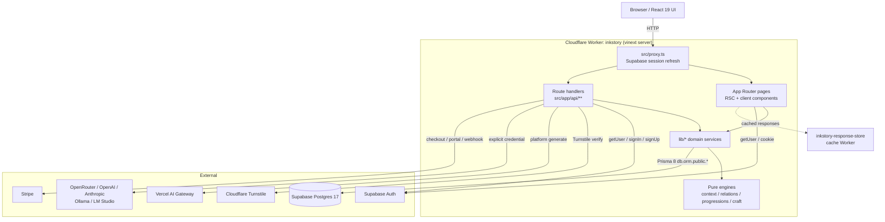
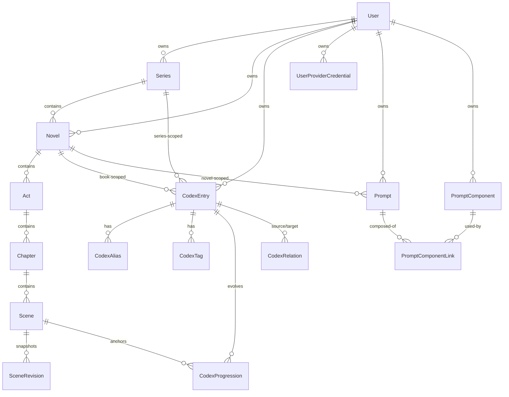
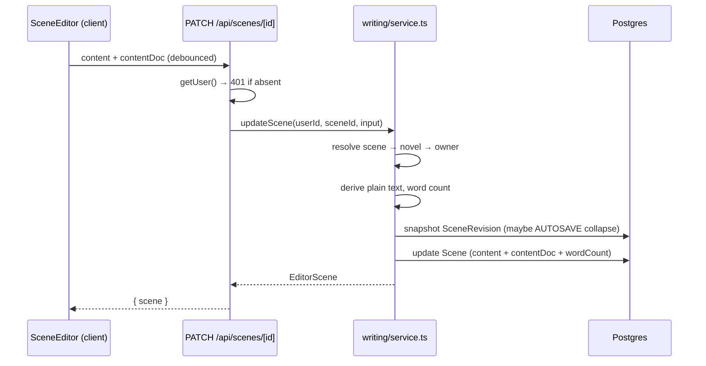
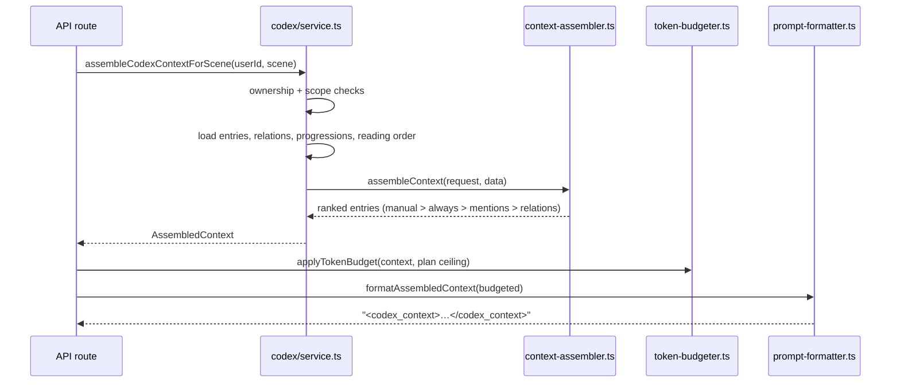
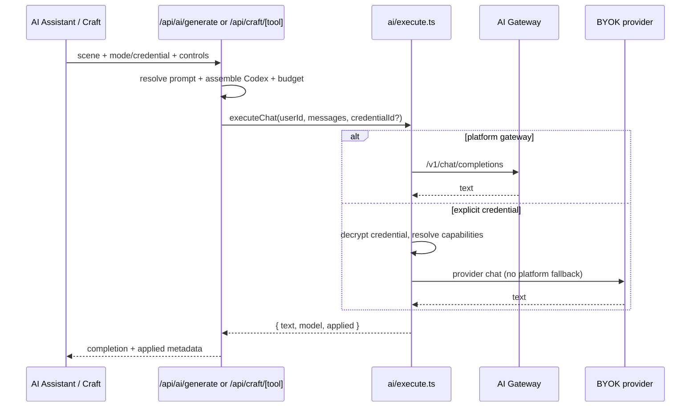

# Architecture Overview

InkStory is a novel-writing and world-building platform built around an **AI-aware Story Codex**. It is a full-stack React 19 application served by `vinext` on Cloudflare Workers, backed by Supabase Postgres through the contract-first Prisma 8 ORM, with Supabase Auth, Stripe billing, and pluggable AI providers.

This document is for developers who need to understand how the system is wired and where to make changes. For setup, usage, and the REST API reference, see [README.md](./README.md) and [AGENTS.md](./AGENTS.md).

## System Summary

| Layer             | Technology                                                                                        |
| ----------------- | ------------------------------------------------------------------------------------------------- |
| App framework     | `vinext` 1.4 (Next.js App Router API), React 19, RSC                                              |
| Hosting / runtime | Cloudflare Workers (`inkstory`) + auxiliary response-store cache Worker                           |
| Language / build  | TypeScript (strict), Vite+ (`vp`), Bun 1.4, Oxlint/Oxfmt, Vitest, Playwright                      |
| Data              | Supabase Postgres 17, Prisma 8 ("Prisma Next") contract-first (`@prisma/orm-postgres`)            |
| Auth              | Supabase Auth (`@supabase/ssr`) cookie sessions                                                   |
| Anti-abuse        | Cloudflare Turnstile on login/signup, fail-closed                                                 |
| Editor            | TipTap 3 (JSON doc + plain-text extract)                                                          |
| Styling           | Tailwind CSS 4, OKLCH `ink-*` token ramp, light "Parchment Desk" / dark "Obsidian Desk"           |
| AI                | Vercel AI Gateway (default) + 5 BYOK providers (OpenRouter, OpenAI, Anthropic, Ollama, LM Studio) |
| Billing           | Stripe Checkout / Portal / webhook; `FREE` / `PRO` / `STUDIO` entitlements                        |
| Import / export   | `.docx` / `.md` / `.html` import; Markdown and DOCX export                                        |

## High-Level Architecture



### Request lifecycle

1. **`src/proxy.ts`** runs on every non-static request. It calls `updateSession` (`@supabase/ssr`) to refresh the access-token cookie and forwards refreshed cookies downstream. It also redirects OTP-style links (`?code=` / `?token_hash=`) to `/auth/callback`.
2. **Page or Route Handler** resolves the current user with `createSupabaseServerClient().auth.getUser()`. Pages redirect unauthenticated users to `/login`; API routes return `401`.
3. **Auth mirroring**: dashboard server components call `syncAuthUser(user)` (`src/lib/supabase/auth.ts`) to upsert the Supabase user into `public.users` by id.
4. **Domain service** in `src/lib/<domain>/` performs ownership checks, validation, quota checks, and database work through `db` (`src/lib/prisma.ts`).
5. **Errors** are thrown as typed errors (`CodexError`, `PromptError`, `AiError`, `ImportError`, `ExportError`, etc.) and mapped to `{ error, code }` JSON with the domain's `handle*ApiError` helper.
6. **Database access** goes through a `db` proxy that resolves the correct Prisma client per context (see "Prisma on Workers" below).

## Project Structure

```text
src/
├── proxy.ts                    # Session-refresh boundary (not middleware.ts)
├── app/
│   ├── page.tsx                # Marketing landing page
│   ├── layout.tsx              # Root layout, theme bootstrap, Better Stack script
│   ├── globals.css             # Tailwind 4 + ink-* token definitions
│   ├── login/ /signup/         # Auth forms (Turnstile)
│   ├── auth/callback/          # PKCE / OTP verification + safe redirect
│   ├── dashboard/
│   │   ├── page.tsx            # Library metrics, novel list, onboarding
│   │   ├── codex/              # CodexManager + editor/modals
│   │   ├── novels/[id]/        # WritingWorkspace: Writer / Stage / Architect
│   │   └── settings/           # BYOK credentials + system prompt duplication
│   └── api/                    # 47 route handler files
│       ├── auth/               # login, signup
│       ├── novels/[id]/outline
│       ├── scenes/[id]/        # editor read/write + revisions
│       ├── books/[id]/         # manuscript import / export
│       ├── codex/              # entries, aliases, tags, relations, progressions, interchange
│       ├── context/assemble    # Codex context inspection
│       ├── ai/                 # generate, preview, credentials, capabilities
│       ├── prompts/            # templates, components, portable import/export
│       ├── craft/              # tool registry + tool execution
│       ├── billing/            # checkout, portal, webhook
│       └── health/             # liveness
├── lib/
│   ├── prisma.ts               # Prisma 8 client + db proxy (per-request on Workers)
│   ├── database-env.ts         # .env.local/.env loader for non-test runtimes
│   ├── supabase/               # browser/server/middleware clients, syncAuthUser, DB types
│   ├── library/                # series/novel creation, starter bible
│   ├── writing/                # outline tree, TipTap, revisions, advisory lock, ordering
│   ├── codex/                  # domain service, engines, context assembly, interchange/
│   ├── ai/                     # generation, shared execution, providers/, credentials/, capabilities/
│   ├── prompts/                # templates, components, contracts, rendering
│   ├── craft/                  # Craft Studio tools
│   ├── import/ / export/       # manuscript parsing and rendering
│   ├── billing/                # plans, entitlements, Stripe sync
│   ├── stage/                  # Stage-mode fixtures
│   ├── ui/                     # preferences, a11y helpers, shared auth field
│   └── turnstile.ts / stripe.ts / test-database-*.ts
├── components/                 # shared UI components
prisma/
├── contract.prisma             # Source of truth: 17 models, 11 enums
├── contract.json / contract.d.ts
└── seed.ts                     # Demo fixtures + SYSTEM_DEFAULT prompts
tests/                          # 111 Vitest suites + tests/e2e/ Playwright specs
scripts/test-db.ts              # Disposable Postgres + contract update + Vitest
```

## Data Model

The story hierarchy is **User → Series → Novel → Act → Chapter → Scene → SceneRevision**. Codex entries attach to either a novel (book-scoped) or a series (series-scoped).



Notable models:

- **`Scene`** stores the authoritative plain text in `content` plus optional TipTap JSON in `contentDoc` (`contentFormat`: `PLAIN` | `TIPTAP_JSON`) and a server-computed `wordCount`.
- **`SceneRevision`** holds immutable snapshots with a `reason` (`AUTOSAVE`, `MANUAL`, `RESTORE`, `IMPORT`); the newest 50 per scene are kept, and autosaves within 60 seconds collapse.
- **`CodexEntry`** has `trackingMode` (`ALWAYS` | `DETECTED` | `NEVER`) and `seriesScoped`. Third-party interchange metadata lives under `customFields._inkstoryInterchange`.
- **`UserProviderCredential`** stores AES-256-GCM ciphertext (`ciphertext`, `iv`, `authTag`) and never returns secrets via API.
- **`StripeWebhookEvent`** claims event ids for idempotent webhook processing.
- Every user-owned model is soft-deleted via `deletedAt` and queried with `deletedAt.isNull()`; hard delete is opt-in (`?hard=true`).

## Core Modules

### Prisma 8 on Workers (`src/lib/prisma.ts`)

The contract is compiled to `prisma/contract.json`; the runtime creates a client with `postgres<Contract>({ contract, url })` and exposes `db.orm.public.<Model>`.

- On Cloudflare Workers, sockets opened in one request cannot be reused by another, so **each request gets its own client** (`vinext/cache` `cacheForRequest`) and it is closed via `after()` once the response is sent. This prevents warm-isolate hangs.
- On Node (dev, tests), a module singleton is reused across hot reloads.
- `db` is a proxy that resolves the current client per property access and binds functions correctly.

Use `bun run db:update` to apply the contract (there is no `db:migrate`/`db:studio` in Prisma 8) and `bun run contract:emit` after installing with `--ignore-scripts`.

### Auth & anti-abuse (`src/lib/supabase/*`, `src/lib/turnstile.ts`)

- `createSupabaseServerClient()` uses cookies; `src/proxy.ts` is the only refresh boundary.
- Login/signup route handlers verify a Turnstile token server-side (`verifyTurnstileToken`) and **fail closed** (403) when `TURNSTILE_SECRET` or `TURNSTILE_HOSTNAMES` is missing.
- `/auth/callback` handles PKCE `code` and OTP `token_hash` flows with control-character and open-redirect checks.
- E2E auth (`e2e-user` cookie) is gated behind `NODE_ENV !== "production" && NEXT_PUBLIC_E2E === "true"`.
- Authorization is enforced in services by walking the ownership chain (scene → chapter → act → novel → owner) and returning `403`/`404` consistently.

### Writing desk (`src/lib/writing/*`)

- `getNovelOutline` loads Act → Chapter → Scene with word-count rollups; every sibling list is ordered by `byPositionThenCreated` (position, then created time, then id).
- Any transaction mutating structure ordering (create, move, import) takes `lockNovelStructure(tx, novelId)` — a `pg_advisory_xact_lock` — as its **first statement**.
- `updateScene` dual-writes plain text and TipTap JSON. When both are sent, the plain text must equal the text derived from the doc. Meaningful changes create revision snapshots.
- `checkpointScene` creates a `MANUAL` revision before Craft Apply writes to the manuscript.

### Story Codex (`src/lib/codex/*`)

- **Service** (`service.ts`): CRUD for entries/aliases/tags/relations/progressions, scope validation (book vs series), mention scanning, progression resolution, and `assembleCodexContextForScene` (the DB-loading half of context assembly shared by Generate, Preview, Craft, and the inspection API).
- **Mention detection** (`mention-detection.ts`): case-insensitive, word-boundary matching; longer matches win.
- **Relation engine** (`relation-engine.ts`): pure BFS expansion with cycle detection, dedupe, default depth 2.
- **Progression engine** (`progression-engine.ts`): resolves `ADDITION` / `REPLACEMENT` descriptions in Act → Chapter → Scene reading order, filtered to progressions at or before the current scene.
- **Assembler** (`context-assembler.ts`): pure and deterministic. Steps: scope filter → seeds (manual attachments → `ALWAYS` → detected mentions) → relation expansion → rank/truncate (default 40, manual > always > mentions > relation depth) → apply progressions at the scene.
- **Budgeting & formatting** (`token-budgeter.ts`, `prompt-formatter.ts`, `context-inspection.ts`): clamps to the plan's context-token ceiling and renders the `<codex_context>` XML block. The Context Inspector responses reuse these exact code paths.
- **Interchange** (`interchange/*`): SillyTavern Lorebook and Character Card v2 import/export/preview, preserving third-party metadata under the reserved envelope. Generic CRUD must not forge or drop that envelope (`protectReservedEnvelope` / `stripReservedEnvelope`).

### AI generation & BYOK (`src/lib/ai/*`)

- `generate.ts` calls the OpenAI-compatible Vercel AI Gateway (`AI_GATEWAY_BASE_URL`, model `AI_MODEL`, default `anthropic/claude-sonnet-4.6`). Without `AI_GATEWAY_API_KEY` it throws `AI_NOT_CONFIGURED` (503) so `/api/ai/generate` can return the assembled prompt with zero spend.
- `execute.ts` (`executeChat`) is the shared execution path for Generate and Craft. It can run through the platform gateway or an explicitly selected stored credential.
- BYOK credentials are encrypted at rest and are never exposed. An explicit BYOK request **never falls back to platform spend** on failure.
- Providers (`providers/*`): OpenRouter, OpenAI, Anthropic, Ollama (local, no key), LM Studio (local, no key).
- Capabilities (`capabilities/*`): server-resolved controls (`temperature`, `minP`, OpenRouter endpoint pinning, guidance support) — client-supplied capability maps are ignored. Unsupported controls fail before the provider call.
- Worker constraint: use `dns.resolve4`/`dns.resolve6` for host resolution, never `node:dns` `lookup`.

### Prompts & Craft Studio (`src/lib/prompts/*`, `src/lib/craft/*`)

- Prompt resolution order: **novel active → user default for the mode → `SYSTEM_DEFAULT`**. System rows are read-only; authors duplicate them into their library.
- Components carry an optional versioned JSON `contract` (context slices, inputs, outputs, attribution) that makes them portable. Export strips ids/owners/timestamps; import validates and always creates a new user-owned component.
- Craft tools are registered in `craft/tools.ts` (`describe`, `expand`, `rewrite`, `show_dont_tell`, `transition`) and served by `/api/craft/[tool]`. `prepareCraftPrompt` validates inputs, checks `excludeFromAi`, assembles only the Codex slices the tool declares, and renders the prompt. Results are returned to the editor and are never auto-written.

### Import / export & billing (`src/lib/import/*`, `src/lib/export/*`, `src/lib/billing/*`)

- Import enforces a 10 MB streaming cap, supports `.docx`/`.md`/`.html`, and runs preview + confirm. Confirm writes the whole manuscript in one transaction under the novel structure lock, optionally adopting the detected title.
- Export loads the same ordered tree as the outline and renders Markdown or DOCX.
- Plans are defined in `billing/plans.ts` (`FREE`: 1 novel, 30 entries, 4k tokens; `PRO`: unlimited, 6k; `STUDIO`: unlimited, 6k + series sharing). Guards throw `QUOTA_EXCEEDED` (402).
- Stripe webhooks deduplicate by claiming `StripeWebhookEvent` rows.

### UI workspace (`src/app/dashboard/novels/[id]/_components/*`, `src/lib/ui/*`)

- `WritingWorkspace` progressively discloses three modes: **Writer** (outliner + editor), **Stage** (fixture rehearsal console), **Architect** (rail with Codex/context tooling).
- All modes share the scene editor, autosave/draft recovery, AI Assistant drawer, Context Inspector, Token Budget Bar, and Craft Panel.
- Theme, prose font, and workspace mode persist in `localStorage`; a pre-paint script in `src/app/layout.tsx` avoids flashes. Components must use token classes (`bg-app`, `bg-card`, `text-primary`, `text-muted`, `border-subtle`, `bg-budget-*`) rather than hardcoded colors.
- Stage Mode currently runs typed fixtures (`src/lib/stage/fixtures.ts`); the multi-agent backend is not wired.

## Data Flows

### Scene autosave



### Context assembly (Generate / Preview / Craft / Inspector)



### AI generation with BYOK option



## Common Patterns

- **Service-layer ownership checks.** Every domain function accepts `userId` as its first argument and re-derives ownership from the DB rather than trusting client ids.
- **Soft delete by default.** Reads filter `deletedAt.isNull()`; deletes set `deletedAt`; hard delete is explicit.
- **Typed errors + shared handlers.** `CodexError(message, code, status)` is the common shape; each domain maps to JSON with a stable `code`.
- **Pure engines, thin services.** Ranking, expansion, progression, budgeting, and rendering are pure functions; DB loading stays in services. This keeps matching rules in one place and unit-testable.
- **Transactions for multi-row writes.** Import confirm, prompt component replacement, and quota-checked novel creation use `db.transaction`.
- **Advisory locks for ordering.** Any write that can change Act/Chapter/Scene order locks the novel first.
- **Server-resolved AI capabilities.** Never trust client capability declarations; resolve them from provider metadata/model id.

## How-To Guides

### Add an API endpoint

1. Create `src/app/api/<path>/route.ts`.
2. Resolve the user with `createSupabaseServerClient()` and return `401` when absent.
3. Parse and validate the body; put business logic in `src/lib/<domain>/service.ts`, not in the route.
4. Catch errors with the domain handler (`handleCodexApiError`, `handleGenerationApiError`, `handlePromptApiError`, or the local import/export handler).
5. Add `tests/<feature>-api.test.ts`. If the suite needs Postgres, add the file to `DB_TEST_FILES` in `vite.config.ts`.

### Add or change a database field

1. Edit `prisma/contract.prisma` (source of truth).
2. Run `bun run contract:emit`, then `bun run db:update` (uses `DIRECT_URL`).
3. Update the relevant service, DTO/types, and tests.
4. Add an index when filtering by the new field; keep the `@map` snake_case naming convention.

### Add a Codex context rule

1. Implement the rule as a pure function in `context-assembler.ts` or a dedicated engine.
2. Thread any new data through `AssembleSceneContextInput` / `ContextAssemblyData` in the service.
3. Update `prompt-formatter.ts` / telemetry only if the output shape changes.
4. Add unit tests with deterministic fixtures; keep ranking stable.

### Add a Craft tool

1. Register the tool in `src/lib/craft/tools.ts` with its contract (context slices, inputs, output mode).
2. Add any new input keys/rendering in `craft/prompt.ts` and the prompt contract layer.
3. `/api/craft/[tool]` and `CraftPanel` pick it up from the registry; add `dryRun` coverage.

### Add a dashboard page

1. Create `src/app/dashboard/<segment>/page.tsx` (server component).
2. Call `createSupabaseServerClient().auth.getUser()`, redirect to `/login` if absent, and `syncAuthUser(user)` when the page depends on local rows.
3. Keep interactive parts in `_components/*` client components.
4. Use token classes and provide hover/annotation reasons for disabled controls (accessibility rule in `AGENTS.md`).

### Add a supported AI provider

1. Implement the adapter under `src/lib/ai/providers/`.
2. Add the enum value and credential metadata handling if it is BYOK-only.
3. Register capability resolution in `src/lib/ai/capabilities/` and gate controls accordingly.
4. Never add a fallback from explicit BYOK to platform spend.

## Key Files Reference

| File / area                                  | Purpose                                       | Modify for                              |
| -------------------------------------------- | --------------------------------------------- | --------------------------------------- |
| `src/proxy.ts`                               | Supabase session refresh, OTP redirect        | Auth/session boundary changes           |
| `src/lib/prisma.ts`                          | Prisma 8 client + per-request proxy           | DB client lifecycle, connection config  |
| `prisma/contract.prisma`                     | Data contract (17 models, 11 enums)           | Schema/data-model changes               |
| `src/lib/supabase/{server,middleware}.ts`    | SSR clients                                   | Cookie/session behavior                 |
| `src/lib/writing/service.ts`                 | Outline tree, scene updates, revisions        | Manuscript ordering/editor behavior     |
| `src/lib/writing/novel-lock.ts`              | `pg_advisory_xact_lock` helper                | Concurrency/ordering safety             |
| `src/lib/codex/service.ts`                   | Codex CRUD, scope checks, context loading     | Codex domain rules                      |
| `src/lib/codex/context-assembler.ts`         | Deterministic context selection               | Ranking/seed/expansion rules            |
| `src/lib/codex/token-budgeter.ts`            | Token-budget pruning/truncation               | Budget behavior                         |
| `src/lib/codex/prompt-formatter.ts`          | `<codex_context>` XML                         | Prompt wire format                      |
| `src/lib/ai/generate.ts` / `execute.ts`      | Gateway + shared chat execution               | Generation/BYOK behavior                |
| `src/lib/ai/credentials/*`                   | AES-256-GCM BYOK storage                      | Credential security                     |
| `src/lib/prompts/service.ts`                 | Prompt resolution + components                | Template resolution/duplication         |
| `src/lib/craft/*`                            | Craft Studio registry and prompt prep         | Adding/changing craft tools             |
| `src/lib/billing/{plans,entitlements}.ts`    | Tier limits and guards                        | Paywall/quota changes                   |
| `src/lib/import/*`, `src/lib/export/*`       | Manuscript I/O                                | File-format support                     |
| `src/app/dashboard/novels/[id]/_components/` | Writing workspace UI                          | Editor, drawers, modes                  |
| `vite.config.ts`                             | Vite+/vinext/Vitest config, DB test file list | Test partitioning, aliases, lint/format |
| `cloudflare.config.ts`                       | Worker bindings and public runtime config     | Deploy/runtime configuration            |

## Testing & Quality Gates

- `bun run test` — disposable Postgres 17 (`scripts/test-db.ts`), applies the contract, runs all Vitest suites.
- `bun run test:no-db` — fast unit run (`INKSTORY_NO_DB=1`), skipping `DB_TEST_FILES`.
- `bun run test:e2e` — Playwright specs in `tests/e2e/` with `NEXT_PUBLIC_E2E=true`.
- `bun run typecheck`, `bun run lint`, `bun run format:check` — Vite+ quality gates.
- `tests/setup-env.ts` loads **only** `.env.test`; `src/lib/test-database-guard.ts` aborts on non-loopback hosts or Supabase project refs (`INKSTORY_UNSAFE_TEST_DATABASE`).

## Troubleshooting

| Symptom                                            | Likely cause / fix                                                                                           |
| -------------------------------------------------- | ------------------------------------------------------------------------------------------------------------ |
| Dashboard hangs on warm Workers requests           | A pooled DB client is being reused across requests; keep the per-request client path in `src/lib/prisma.ts`. |
| Server components see an anonymous user            | `src/proxy.ts` is not refreshing the cookie, or a second `middleware.ts` bypasses `@supabase/ssr`.           |
| Login/signup returns `403`                         | Turnstile secret/hostnames missing or mismatched; verification fails closed by design.                       |
| `/api/ai/generate` returns `503 AI_NOT_CONFIGURED` | No `AI_GATEWAY_API_KEY` and no BYOK credential selected; the assembled prompt is still returned.             |
| `/api/billing/*` returns `503`                     | Missing `STRIPE_SECRET_KEY` (or `STRIPE_WEBHOOK_SECRET` for webhooks).                                       |
| `db:update` blocks or times out                    | `DIRECT_URL` points at the transaction pooler (6543); use the session pooler (5432) for DDL.                 |
| Missing `prisma/contract.json`                     | Install ran with `--ignore-scripts`; run `bun run contract:emit`.                                            |
| Tests abort with `INKSTORY_UNSAFE_TEST_DATABASE`   | Shell env points at a remote DB; unset it and use `bun run test` / `.env.test`.                              |
| Test DB port `5432` busy                           | `INKSTORY_TEST_POSTGRES_PORT=55432 bun run test`.                                                            |

## Known Gaps

- **Stage Mode** runs fixture beats (`src/lib/stage/fixtures.ts`); no multi-agent enactment backend.
- **Craft Studio** has `describe`, `expand`, `rewrite`, `show_dont_tell`, `transition`; `brainstorm` is pending.
- **Interchange & prompt UI** are API-complete but partially surfaced: `CodexManager` has no interchange dialog yet, and settings only duplicates `SYSTEM_DEFAULT` prompts.
- **RLS**: models carry `@@rls` markers in the contract, but runtime authorization is enforced in service-layer ownership checks.
